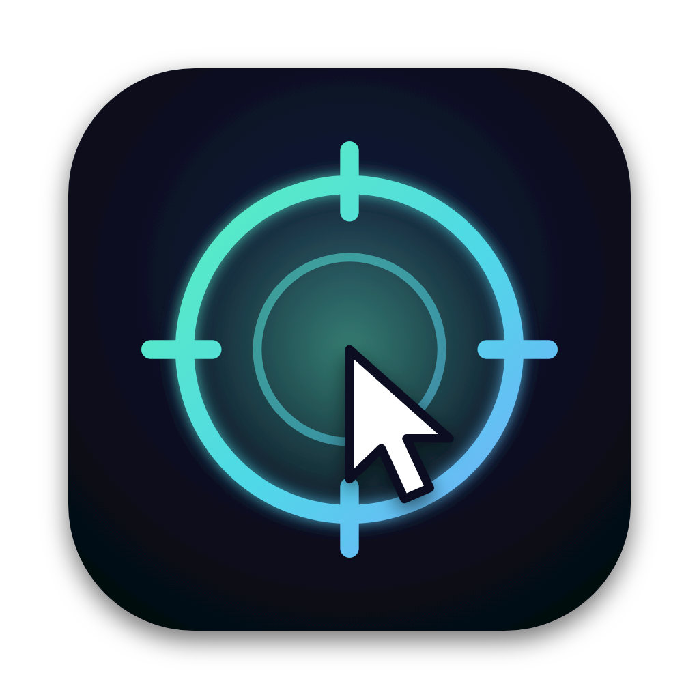

<p align="center"></p>

# AimMac

Turn your **iPhone**, **iPad**, or **Apple Watch** into a pointer for your Mac. Aim it at the screen to move the cursor, tap to click, hold to drag.

The devices talk directly to the Mac over Bluetooth.

> Status: the Mac app and the iPhone app work (tested on iOS 27.2). The Apple Watch app is written but has not been tested on a real watch yet.

## What it does

- **Point like a laser.** The cursor goes where the top edge of your device points (12 o'clock on the watch). Up/down comes from gravity, so it never drifts. Works across all your displays.
- **Tap** to click, **double-tap** to double-click, **hold** to drag, a **right-click** button, and scrolling (Digital Crown on the watch, a scroll strip on iPhone and iPad).
- **Trackpad mode on iPhone and iPad.** Lay the device on the table and slide a finger. Use the drag lock to move windows. On iPad, the control surface fills the available space in portrait and landscape.
- **Center** re-aims the middle of the screen. **Pause** frees the cursor for your real trackpad.
- **Pairing with approval.** The first time a device connects, the Mac asks you to allow it. Devices you didn't allow can't move the cursor.
- **Notch panel.** Hover the notch (or the middle of the menu bar) to see the connected device, its battery, a live aim map and quick buttons. Pin it to keep it open.
- **Orbit Pop**, a small target game to try it on.

## Requirements

- Mac with macOS 14 or later, Apple silicon or Intel, with Bluetooth
- iPhone with iOS 17 or later, iPad with iPadOS 17 or later, or Apple Watch with watchOS 10 or later
- Xcode 15 or later (use a version that supports your device's OS)

## 1. Mac receiver

```bash
cd Mac
chmod +x build.sh
./build.sh run
```

The first launch asks for **Bluetooth** and **Accessibility** (System Settings › Privacy & Security › Accessibility). Accessibility is what lets it move the cursor. Allow both.

After a rebuild macOS may forget the Accessibility permission. If the cursor stops moving, turn AimMac off and on again in that list.

## 2. iPhone, iPad, and Apple Watch apps

With [XcodeGen](https://github.com/yonaskolb/XcodeGen):

```bash
brew install xcodegen
cd Apple
xcodegen
open AimMac.xcodeproj
```

1. Sign with your Apple ID: create `Apple/Local.xcconfig` with your bundle prefix and Team ID (see `Apple/Config.xcconfig`), or just pick your Team in **Signing & Capabilities**. A free Apple ID works.
2. Choose your iPhone, iPad, or Apple Watch as the run destination and press **⌘R**. On iPhone or iPad, turn on **Developer Mode** (Settings › Privacy & Security) and trust your developer profile if prompted (Settings › General › VPN & Device Management).
3. Open AimMac on the device, tap **Pair** next to your Mac, then click **Allow** on the Mac.

With a free Apple ID, apps you install from Xcode stop opening after 7 days; just run them again from Xcode.

<details>
<summary>Without XcodeGen</summary>

1. Xcode › File › New › Project › iOS › App, name it `AimMac`, SwiftUI.
2. File › New › Target › watchOS › App, name it `AimMacWatch`, as a watch-only app.
3. Delete the generated `…App.swift` and `ContentView.swift` files from both targets.
4. Drag in `Apple/iOS` (iOS target only), `Apple/Watch` (watch target only), and `Apple/Shared` plus `Shared/Protocol.swift` (both targets).
5. In each target's **Info** tab add `Privacy - Bluetooth Always Usage Description` and `Privacy - Motion Usage Description`.

</details>

## Using it

Hold the device like a remote with its top edge toward the screen. Point at the middle of the screen and tap **Center**.

Speed, smoothing and axis inversion live in the AimMac menu on the Mac.

Watch tips: on the iPhone's Watch app turn off **Passcode › Wrist Detection** if you hold the watch in your hand, set **Display & Brightness › Wake Duration** to 70 seconds, and **General › Return to Clock › AimMac** to one hour. Long-press the watch screen for settings and unpairing.

## Using AimMac on iPad

1. 在 Mac 上启动 AimMac 接收端，并在「系统设置 → 隐私与安全性」中允许 AimMac 使用蓝牙和辅助功能。
2. 在 iPad 上打开 AimMac，点 Mac 名称旁的 **Pair**，再到 Mac 的弹窗点 **Allow**。iPad 上 Mac 名称旁的绿点亮起后即可开始操作。

| 控件 | 用法 |
| --- | --- |
| **Pointer** | 拿起 iPad，用机身顶边对准 Mac 屏幕中央，点 **Center** 校准。转动 iPad 移动光标。左侧大区轻点是左键，按住并转动 iPad 可拖拽。 |
| **Trackpad** | 将 iPad 平放，在左侧大区滑动手指来移动光标，轻点是左键。点 **Hold** 锁住左键，滑动拖拽，完成后点 **Release**。 |
| **Scroll** | 把 Mac 光标移到可滚动的内容上，再用一根手指在 iPad 右侧带上下箭头的条内滑动。两个模式都可使用。 |
| **Right click** | 在 Mac 光标所在位置打开右键菜单。 |
| **Center** | 把当前瞄准方向校准到 Mac 屏幕中央。 |
| **Pause / Resume** | 暂停或恢复控制。Mac 名称旁的圆点在暂停时变为橙色。 |
| **齿轮** | 查看当前配对的 Mac、解除配对和阅读使用提示。 |

## Orbit Pop

Click **Game** in the notch panel or **Play the target game** in the menu. Press **F** for full screen. Rings shrink and fade; pop them before they collapse. Center hits score double, gold rings triple, and every hit in a row raises your combo.

## How it works

- **Device** (`Apple/`): reads gravity and the gyroscope 100 times a second. Up/down is the angle of the top edge above the horizon; left/right adds up turns around the true vertical. Each sample carries the device's timestamp.
- **Mac** (`Mac/`): projects the aim onto the screen like a laser hitting a wall, smooths it with a [1€ filter](https://gery.casiez.net/1euro/) using the device's timestamps, and eases the cursor toward it 240 times a second on its own thread. A click lands where you were aiming the moment your finger touched the screen, so the tap's jolt doesn't move it.
- **Bluetooth**: the Mac advertises a service; the device connects and writes small packets. The protocol is documented at the top of `Shared/Protocol.swift`.

## Credits

Inspired by [WatchPointer](https://github.com/umarz317/WatchPointer) by umarz317. AimMac is a separate implementation written from scratch.

## License

MIT
